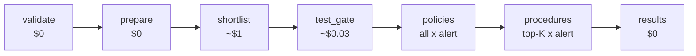
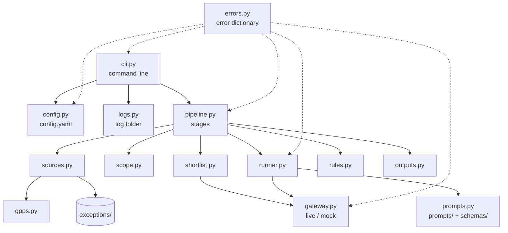
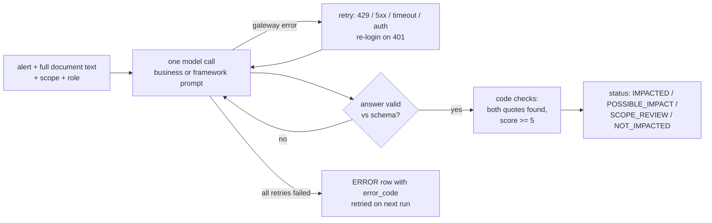

# Alert → Policy / Procedure Impact Assessment: production package

**Owner:** RCAI&A · **Version:** 1.0.0 · **Python:** 3.9+

This package is the production version of the validated notebook "IA_PP_NB1_production_run". For every regulatory alert in scope, it finds the GPPS **policies and procedures** the alert impacts and the exact **section / sub-section**, with verbatim evidence from both texts.

- **Policies:** the model reads every policy for every alert.
- **Procedures:** a search step shortlists the top 200 per alert, and the model reads each of them in full.
- **One model call per (alert, document).** There is no audit call in production; the audit is a separate notebook.

The code, prompts and decision rules are the ones validated on the US run (161 alerts, Nov 2026). The prompts are byte-for-byte identical to that run's, which `tests/test_offline.py` checks.

---

## 1. Folder structure

```
ia_policy_procedure/
├── README.md                    this document
├── requirements.txt             Python packages
├── config/
│   └── config.yaml              EVERY execution parameter (model, max tokens, seed, concurrency, paths, rules ...)
├── prompts/                     one file per prompt, sent verbatim (only {{COUNTRY_NAME}} is filled in)
│   ├── query_plan.md            alert -> search queries (procedure shortlist)
│   ├── policy_business.md       alert x policy
│   ├── policy_framework.md      alert x framework / process policy (adds the framework rule)
│   ├── procedure_business.md    alert x procedure
│   └── procedure_framework.md   alert x framework / process procedure
├── schemas/                     one JSON Schema per prompt: the expected answer
│   ├── query_plan.schema.json
│   ├── policy_business.schema.json      policy_framework.schema.json
│   └── procedure_business.schema.json   procedure_framework.schema.json
├── exceptions/
│   ├── framework_documents.csv  documents read with the framework rule (POL-42, PROC-1633, POL-79, POL-40, POL-83)
│   └── skip_documents.csv       documents never read (empty by default)
├── ia_pp/                       the code (python package)
│   ├── __main__.py / cli.py     command line: run, check, status, compare, explain, errors
│   ├── config.py                reads and checks config.yaml (types, ranges, placeholders, env-var secrets)
│   ├── errors.py                ERROR DICTIONARY (codes, cause, action) + exit codes
│   ├── logs.py                  log folder per run: run.log, errors.jsonl, llm_calls.jsonl, run_summary.json
│   ├── pipeline.py              stage orchestration, cost gate, test gate, final exit code
│   ├── sources.py               alerts, GPPS documents, exception lists -> one Context object
│   ├── gpps.py                  GPPS JSON -> sections -> sub-sections (GPPS UI numbering)
│   ├── scope.py                 GLOBAL / LOCAL (this country) / LOCAL (other country)
│   ├── shortlist.py             procedure search: query plans + embeddings + rank fusion (top-K)
│   ├── gateway.py               bank AI gateway (live) and offline simulator (mock); error classification
│   ├── prompts.py               loads prompts + schemas, validates every answer
│   ├── runner.py                one call per pair, worker pool, checkpoint, cost cap, circuit breaker
│   ├── rules.py                 quote check, LINKED rule, jurisdiction, framework rule, bands
│   ├── outputs.py               result files + run record
│   └── compare.py               compares two runs (e.g. notebook vs package on 10 alerts)
├── tools/
│   ├── make_fake_data.py        synthetic data + config.smoke.yaml for an offline test
│   └── unpack_bundle.py         rebuilds this folder from the text bundle
├── tests/
│   ├── test_offline.py          unit tests (live-gateway path with a stub, prompt identity, rules)
│   └── us_prompts_reference.json  the validated US prompts (for the identity test)
└── docs/
    └── ERROR_CODES.md           all error codes (generated: python -m ia_pp errors)
```

---

## 2. How it works

### 2.1 Stages



| Stage | What it does | Cost (US, 161 alerts) | Resumable |
|---|---|---|---|
| validate | Packages, config, prompts, schemas, exceptions, sources, output folder, one gateway call | $0 | n/a |
| prepare | Alerts in scope, GPPS sections / sub-sections, document scope (global / local) | $0 | cached |
| shortlist | Query plan per alert, embeddings, rank fusion → top-K procedures per alert | ~$1 | yes |
| test_gate | 10 pairs before the first full run: errors ≤ 1, quotes found ≥ 70%, projected cost ≤ cap | ~$0.03 | n/a |
| policies | Every policy × every alert, one call each | ~$58 | yes |
| procedures | Shortlisted procedures × alert, one call each | ~$51 | yes |
| results | Decision rules, bands, result files, run record | $0 | re-runnable |

`validate` and `prepare` always run, because they cost nothing and every later stage needs them. `--stage` chooses the others.

### 2.2 Code structure



If your viewer does not render diagrams, the same structure in text:

```
cli -> config, logs, pipeline
pipeline -> sources (gpps, exceptions) -> scope -> shortlist (gateway, prompts) -> runner (gateway, prompts)
         -> rules -> outputs
errors: used everywhere (every failure carries a code)
```

### 2.3 One (alert, document) pair



### 2.4 Decision rules (agreed, unchanged from the US run)

1. **LINKED:** the model says LINKED, link_score ≥ `rules.link_threshold` (5), and **both verbatim quotes** are found in the texts by code.
2. **Jurisdiction:** a link to another country's LOCAL document becomes `SCOPE_REVIEW`, never `IMPACTED`.
3. **Framework / process documents** (`exceptions/framework_documents.csv`): impacted only if the alert itself requires that process to change (`framework_change = YES`).
4. **Bands:**
   - `IMPACTED`: link_score ≥ `rules.headline_min_score` (8);
   - `POSSIBLE_IMPACT`: link_score 5–7, the SME review queue;
   - `NOT_IMPACTED`: everything else.

---

## 3. Configuration: `config/config.yaml`

The code holds no execution parameter. Everything is in this file.

| Section | Holds |
|---|---|
| `run` | run id, output and log folders, alert selection (`alert_ids`, `alerts_limit`), `max_cost_usd`, `test_gate`, `reuse_search_from` |
| `country` | code, name (fills `{{COUNTRY_NAME}}` in the prompts), terms / codes / legal-entity codes that mark local documents |
| `sources` | the 5 input files (parquet / csv / xlsx; a glob takes the newest file) |
| `gateway` | `mode` (live / mock), base URL, staff id, use case, quota project (**each with an environment variable name**), token lifetime, timeouts, connections |
| `model` | `chat_model`, `family`, **`max_tokens`**, **`temperature`**, **`seed`**, `reasoning_effort`, prices, embedding model and batch size |
| `execution` | **`concurrency`**, query-plan / embedding concurrency, retries, back-off, circuit breaker, checkpoint frequency, progress frequency |
| `search` | `proc_top_k` (200), fusion and TF-IDF settings |
| `rules` | `published_only`, `link_threshold`, `headline_min_score` |
| `logging` | level, per-call log, payload log (debug only) |
| `paths` | prompts / schemas / exceptions folders |

**Secrets.** In production, set the gateway settings as environment variables, not in the file:
- `IA_GATEWAY_BASE_URL`
- `IA_STAFF_ID`
- `IA_USE_CASE`
- `GOOGLE_CLOUD_QUOTA_PROJECT`

An environment variable always wins over the file. A value still reading `<your ...>` stops the run with `E-CFG-005` before anything is spent.

**Model parameters as validated.**
- **gpt-family models** get `max_completion_tokens`.
- **gemini-family models** get `max_tokens`, `temperature`, `seed` and `reasoning_effort`.

`model.family: auto` decides from the model name.

---

## 4. Prompts, schemas and exceptions

**Why these formats.**
- **Prompts are plain text in `.md` files**, one per prompt. The file is sent to the model exactly as written, so what you read is what the model gets. Reviewers can diff it in git, and it needs no escaping. The only placeholder is `{{COUNTRY_NAME}}`; any other `{{...}}` stops the run with `E-PRM-002`.
- **Schemas are standard JSON Schema**, one per prompt, describing the expected answer.
  - The fields in `required` must be valid, otherwise the answer is retried (`E-LLM-003`).
  - Any other invalid field is set to null and logged (`W-LLM-001`); the answer is kept.
  - Values are coerced leniently (`"8"` → 8, `"linked"` → `LINKED`), matching how the validated notebook read answers.

**Changing a prompt.** Edit the `.md` file, run a 10-alert comparison (section 7), and agree the change with RCAI&A. The run copies the exact prompts and schemas it used into `<output_dir>/production/`.

**Exceptions** (CSV with the header `doc_id,title,reason`; lines starting with `#` are comments):

| File | Effect |
|---|---|
| `framework_documents.csv` | **Read with the framework rule** (impacted only if the alert requires the process itself to change) |
| `skip_documents.csv` | **Never read** and never in the results. Empty by default; agree each line with RCAI&A |

---

## 5. Running in production (no IDE needed)

Run everything from the project folder (the one that holds `config/`).

```bash
pip install -r requirements.txt                                     # once (py_group_ai_tools comes from the platform)
python -m ia_pp check  --config config/config.yaml                  # validates everything + 1 gateway call ($0)
python -m ia_pp run    --config config/config.yaml                  # full run
python -m ia_pp status --config config/config.yaml                  # progress, spend so far
```

| Need | Command |
|---|---|
| Resume after a stop / crash / partial run | **The same command again.** Finished pairs are kept; failed pairs are retried |
| One stage only | `--stage results` (or `shortlist`, `policies`, `procedures`, a comma list) |
| A few alerts into a separate folder | `--alert-ids 159763,158001` or `--alert-ids-file ids.txt`, plus `--output-dir ../output/test_10` |
| Offline simulation (no gateway, no cost) | `--mock` |
| Explain an error code | `python -m ia_pp explain E-GW-004` |

**Exit codes**, for the scheduler:

| Exit code | Meaning | Action |
|---|---|---|
| 0 | All pairs answered | none |
| 1 | Completed, some pairs without an answer | Re-run the same command |
| 2 | Config / environment / prompt / source problem | Fix the cause in the message. Nothing was spent |
| 3 | Gateway unusable | Check `errors.jsonl`, then re-run |
| 4 | Cost cap reached | Progress is saved. Raise `run.max_cost_usd` if expected, then re-run |
| 5 | Test gate failed | Read the test table in `run.log` |
| 6 | Internal error | Send `run.log` to RCAI&A |
| 130 | Interrupted | Re-run the same command |

**Stopping safely.** Ctrl+C or SIGTERM lets the calls in hand finish, flushes the checkpoint and exits with code 130. The checkpoint is append-only JSON lines (`policy_ckpt.jsonl`, `procedure_ckpt.jsonl`), so a hard kill loses at most the last few seconds.

---

## 6. Simulating in your Jupyter environment

The steps below run the same commands production will run. In a notebook, a cell starting with `!` runs a shell command in a separate process, exactly like a scheduler. Long runs can also go in a Jupyter terminal (File > New > Terminal) if one is available.

**Step 1. Get the files in.** Upload the bundle part(s) (`IA_PP_BUNDLE_part*.txt`, text only) to a folder on the server with the Jupyter file browser. Then, in a notebook cell in that folder, run the unpacker. It is a self-contained copy of `tools/unpack_bundle.py`:

```python
import re, os, hashlib, glob
HEAD = re.compile(r"^#### FILE: (.+?) \| sha256=([0-9a-f]{64}) ####$")
files, cur = {}, None
for part in sorted(glob.glob("IA_PP_BUNDLE_part*.txt")):
    for line in open(part, encoding="utf-8", newline="").read().split("\n"):
        m = HEAD.match(line)
        if m: cur, dig, buf = m.group(1), m.group(2), []
        elif line == "#### END FILE ####" and cur: files[cur] = ("\n".join(buf), dig); cur = None
        elif cur is not None: buf.append(line)
bad = [p for p, (t, d) in files.items() if hashlib.sha256(t.encode()).hexdigest() != d]
for p, (t, d) in files.items():
    if p not in bad:
        os.makedirs(os.path.dirname(p) or ".", exist_ok=True); open(p, "w", encoding="utf-8", newline="").write(t)
print(f"{len(files) - len(bad)} files written | damaged: {bad or 'none'}")
```

**Step 2. Install and run the offline tests.** These need no bank data, no gateway and cost nothing:

```python
%cd ia_policy_procedure
!pip install -r requirements.txt --quiet
!python tests/test_offline.py
!python tools/make_fake_data.py
!python -m ia_pp run --config config/config.smoke.yaml
```

`test_offline.py` must end with `ALL PASSED`. The smoke run must end with `EXIT 0`. If `pip` cannot reach a package index on your server, the packages are usually already installed: check with `!python -c "import pandas, pyarrow, sklearn, yaml, openai, httpx"` and ask the platform team for any that are missing (the error message names it, `E-ENV-001`).

**Step 3. Configure.**
1. Open `config/config.yaml` in the Jupyter text editor and set `sources` (the real paths, including `alert_scope`).
2. Set `execution.concurrency` (96 was tuned for the US gateway).
3. Set the gateway secrets as environment variables. A `!` command inherits them, as a production job would:

```python
import os
os.environ["IA_GATEWAY_BASE_URL"] = "..."     # your values (never commit them)
os.environ["IA_STAFF_ID"] = "..."
os.environ["IA_USE_CASE"] = "..."
os.environ["GOOGLE_CLOUD_QUOTA_PROJECT"] = "..."
!python -m ia_pp check --config config/config.yaml
```

`check` validates everything and makes one gateway call. It must end with `EXIT 0`.

**Step 4. Live run on 10 alerts and comparison.** See section 7.

You can also run the package from Python, for example to debug in a notebook: `from ia_pp.cli import main; main(["run", "--config", "config/config.yaml", "--mock"])`. It works inside Jupyter because the code runs its event loop in a separate thread.

---

## 7. The 10-alert check against the validated notebook

**1. Pick 10 alert ids** from the US notebook run, mixing alerts with many and few impacts, and save them one per line in `ids_10.txt`.

**2. Share the notebook's procedure shortlist.** This makes the procedures read identical, so the comparison isolates the model. In `config.yaml`, set:

```yaml
run:
  reuse_search_from: "../output/ia_policy_procedure_US/production_run_v1"   # the notebook run folder
```

**3. Run into a separate folder:**

```python
!python -m ia_pp run --config config/config.yaml --alert-ids-file ids_10.txt --output-dir ../output/ia_pp_package_test_10
```

That is about 10 × 482 = 4,820 calls: roughly $8 and 6–10 minutes at concurrency 96.

**4. Compare:**

```python
!python -m ia_pp compare --run-a ../output/ia_policy_procedure_US/production_run_v1 --run-b ../output/ia_pp_package_test_10 --alert-ids-file ids_10.txt
```

This writes `compare_report.xlsx` in the test folder, with four sheets: summary, per alert, the pairs with a different status, and a how-to-read sheet.

**What to expect.**
- **Same pairs:** `only_in_a` / `only_in_b` = 0 when the shortlist is shared.
- **Same status on almost all pairs:** most pairs are clear rejections.
- **Link overlap below 100%:** the same model with the same prompt does not answer identically twice. In the US development runs, about 10% of confirmed links and about a third of borderline links flipped between two runs.

Differences of that size are normal. Investigate a difference only if it is systematic, for example all framework documents, one document type, or many `error_code`s.

---

## 8. Outputs (in `run.output_dir`)

| File | Content |
|---|---|
| **`ia_pp_alert_impacts.jsonl`** | Main output: one JSON per alert with impacted / possible / scope-review documents, sections, evidence, change needed |
| **`ia_pp_pairs.parquet`** | Every (alert, document) read: decision, `impact_status`, score, sections, quotes, reasoning, `error_code` |
| `ia_pp_impacted_sections.parquet` | One row per impacted section / sub-section (GPPS number and title) |
| `ia_pp_results_summary.xlsx` | How to read, summary, per alert, by scope, framework documents, pairs without answer, document scope |
| `production/` | The exact prompts and schemas used, plus `production_config.json` (rules, model, sources, usage) |
| `units.parquet`, `alerts.parquet`, `document_scope.parquet` | Texts exactly as sent to the model; read by the audit notebook |
| `policy_ckpt.jsonl`, `procedure_ckpt.jsonl`, `query_plans.parquet`, `emb_*.npz`, `procedure_shortlist_top*.parquet` | Checkpoints and caches. Keep them; don't share them |
| `spend_ledger.json` | Spend per session and in total, used by the cost cap across restarts |

The column names are the same as the notebook's, so the audit notebook (`IA_PP_NB2_audit_and_storyboard`) reads this folder unchanged.

---

## 9. Logging and debugging

Each run writes a new folder: `run.log_dir/<run_id>/<YYYYmmdd_HHMMSS>/`.

| File | Use it for |
|---|---|
| `run.log` | The full story: every console line, DEBUG detail, tracebacks |
| `errors.jsonl` | Every warning / error as one JSON line: code, stage, alert, doc, detail |
| `llm_calls.jsonl` | Every gateway call: stage, alert, doc, attempt, status, code, milliseconds, tokens, finish reason. No text |
| `payloads.jsonl` | Only when `logging.log_payloads: true`: full model input and answer. Contains document text, so debug only |
| `config_used.yaml` | The effective configuration, secrets masked |
| `run_summary.json` | Stages done, pair counts, usage and cost per stage, count per error code, exit code, the stop reason |

**Every problem has a code.**
- Look one up with `python -m ia_pp explain <code>`, or see `docs/ERROR_CODES.md`.
- A failed pair keeps its code in the `error_code` column of `ia_pp_pairs.parquet`, and on the "pairs without answer" sheet of the Excel file.

**Debugging playbook**

| Symptom | Look at | Typical code → action |
|---|---|---|
| Stops at once, exit 2 | Console message | `E-CFG-*`, `E-SRC-*`, `E-PRM-*`: fix the named setting or file |
| Exit 3 at the start | `run.log` gateway check | `E-GW-008` (wrong model / URL), `E-GW-003` (access): fix the gateway settings |
| Exit 1, some pairs without an answer | `run_summary.json` → `error_codes`, then `errors.jsonl` | `E-GW-004/005/006`: temporary, re-run. `E-GW-009`: document too long for the model |
| Many `E-GW-004` (429) | `llm_calls.jsonl`: share of 429 by minute | Lower `execution.concurrency` |
| Many `E-LLM-004` | `llm_calls.jsonl` → `finish` = length | Raise `model.max_tokens` |
| Exit 3 in the middle, `E-GW-010` | The codes just before it in `errors.jsonl` | The gateway went down. Fix it, then re-run (progress kept) |
| Exit 4 | `spend_ledger.json` | Cost cap. Raise `run.max_cost_usd` if the spend is expected |
| Odd result for one pair | `ia_pp_pairs.parquet` row (reasoning, quotes, sections). Re-run that alert with `logging.log_payloads: true` into a test folder | Compare with the prompt in `production/` |
| Exit 6 | `run.log` traceback (`E-RUN-005`) | Send `run.log` and `errors.jsonl` to RCAI&A |

**Quick look at a run's errors from Python:**

```python
import pandas as pd, glob
d = sorted(glob.glob("../logs/ia_policy_procedure/*/*"))[-1]          # latest run folder
e = pd.read_json(f"{d}/errors.jsonl", lines=True); print(e.code.value_counts())
c = pd.read_json(f"{d}/llm_calls.jsonl", lines=True); print(c.groupby(["stage", "status"]).size(), c.ms.describe())
```

---

## 10. Guard rails at a glance

| Risk | Guard |
|---|---|
| Wrong config / missing file / placeholder | Checked before any call; exit 2, nothing spent |
| A document not sent in full | No-truncation check before the run (`E-RUN-006`) |
| Overspend | Cost gate before the run, plus a live cost cap across sessions (`spend_ledger.json`) |
| Gateway hiccups | Per-call retries with back-off (harder on 429), automatic re-login on 401 |
| Wrong model / URL | Not retried; the stage stops after 5 failures with no success (`E-GW-008`) |
| Gateway down | Circuit breaker after N consecutive failed pairs (`E-GW-010`), progress kept |
| Bad model answer | JSON parsing tolerant of fences and wrappers; schema validation; retry |
| One odd document / bug | Isolated to its pair (`E-RUN-004`, traceback in `run.log`); the run continues |
| Shortlist failure | Procedures skipped for that session; policies still run; exit code reports it |
| Crash / kill | Append-only checkpoints; damaged last line skipped (`W-CKP-001`) |
| Stop request | Calls in hand finish, checkpoint flushed, exit 130 |
| Hallucinated evidence | A link counts only if both quotes are found verbatim by code |

---

## 11. Tests

```bash
python tests/test_offline.py        # unit tests: live gateway via a stub, error classification, prompts, rules
python tools/make_fake_data.py      # synthetic data + config/config.smoke.yaml
python -m ia_pp run --config config/config.smoke.yaml
```

To exercise the guard rails offline, set the following in `config.smoke.yaml`:
- `gateway.mock_failure_rate: 0.3`: ERROR rows, exit 1; re-run with 0 retries only those pairs;
- `gateway.mock_latency_sec: 0.3`: then press Ctrl+C mid-run, and re-run to resume;
- `run.max_cost_usd: 0.05`: exit 4.
